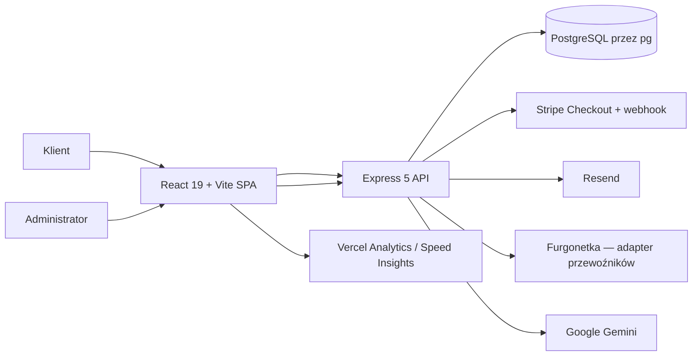
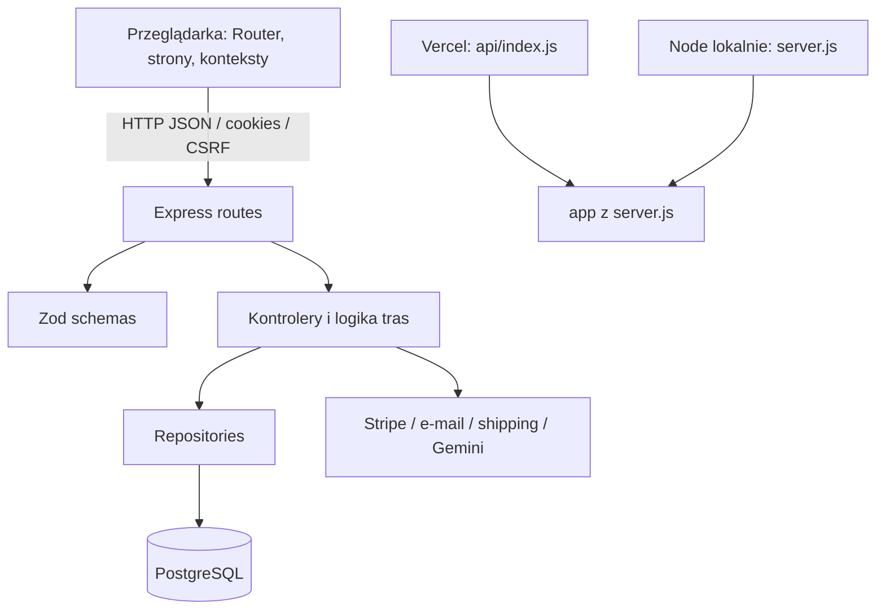

# VitaZone — referencja kodu i architektury

> Status: opis stanu repozytorium na branchu `codex/vitazone-visual-refresh`, 2026-11-14. To referencja do implementacji, nie specyfikacja gotowego produktu. Ścieżki są względne względem katalogu repozytorium. Szczegółowy opis tras i widocznego copy: [audyt tras](route-audit.md); status ryzyk i decyzji: [stan techniczny](current-state-and-roadmap.md).

## Jak czytać tę referencję

Dokumentacja używa trzech poziomów: diagramów systemu i przepływów, map modułów oraz katalogu plików źródłowych. Wpis pliku objaśnia rolę i główną odpowiedzialność, a nie każdą instrukcję linia po linii. Dla złożonych modułów dokładamy kontrakty, skutki uboczne, błędy i testy. Taki układ pozwala utrzymać mapę kodu przy zmianach implementacji; szczegóły funkcji należy aktualizować razem z kodem.

Poniższy opis dotyczy commita `e33917d38ec54813f3b58f8d0dcdf701d44dd89f` (HEAD podczas audytu). Oznaczenia dowodów: **[kod]** — obecność i zachowanie wynikają z odczytanego źródła; **[test/mock]** — zakres istniejących testów opartych na mockach/fixture; **[właściciel/środowisko]** — faktu nie da się ustalić z repo i wymaga potwierdzenia poza nim. Obecność kodu lub testu nie dowodzi aktywnej konfiguracji, realnego ruchu ani działania integracji. Tabele poniżej są mapą odpowiedzialności i głównych punktów wejścia, a nie gwarancją kompletności scenariuszy.

## System — C4 context

**[kod]** VitaZone zawiera SPA React 19/Vite i API Express 5, używające PostgreSQL przez `pg`. API ma lokalny listener w `server.js` i adapter funkcji `api/index.js` dla Vercel. Kod ma adaptery Stripe, Resend, Furgonetka i Google Gemini oraz telemetrię Vercel po stronie UI. **[właściciel/środowisko]** Repo nie potwierdza, że klucze, konta, umowy, deployment, migracje ani produkcyjny ruch są skonfigurowane. Testy dostawców używają stubów/mocków.

**[właściciel/środowisko]** Obecność integracji w kodzie nie potwierdza skonfigurowania kluczy, aktywnego konta, umowy handlowej, produkcyjnego ruchu ani kompletności umów prawnych. Deployment i zewnętrzny stan strony nie były w tym audycie sprawdzane.

## Kontenery i przepływ żądania

### Zakup i płatność — obecne punkty kontroli

1. **[kod]** `CartContext` obsługuje stan koszyka UI i żądania do API. Kwota w UI nie jest źródłem ceny.
2. **[kod]** `POST /api/stripe/create-checkout-session` w `stripeController.createCheckoutSession` waliduje checkout, tworzy zamówienie przez `orderRepository.createOrder`, a następnie tworzy Stripe Checkout Session. Repozytorium w transakcji blokuje/odczytuje produkty, liczy cenę z DB, zmniejsza stock, nalicza rabat, zapisuje snapshot adresu i pozycji, po czym zatwierdza transakcję przed wywołaniem Stripe.
3. **[kod]** Błąd utworzenia sesji uruchamia próbę kompensacji `safelyReleasePendingOrder`; niezależność PostgreSQL i Stripe oznacza, że timeout/niejednoznaczny wynik może rozdzielić stan dostawcy i bazy. Webhook `handleStripeWebhook` dostaje raw body przed `express.json`, weryfikuje podpis i obsługuje zdarzenia płatności.
4. **[kod]** Status sesji ma osobny endpoint; klientowy redirect nie jest samodzielnym potwierdzeniem płatności. Zmiana statusu, wyczerpanie/anulowanie i e-mail są odrębnymi efektami.
5. **[test/mock]** `tests/unit/stripeController.test.js`, `stripePaymentRetry.test.js`, `stripeShippingCheckout.test.js` oraz UI `Checkout.test.jsx` sprawdzają wybrane zachowania na mockach/stubach. Nie dowodzą integracji z prawdziwym Stripe, transakcyjności na PostgreSQL ani stanu konta dostawcy. Przegląd ryzyk: [stan techniczny](current-state-and-roadmap.md) i [plan](../superpowers/plans/2026-11-14-vitazone-engineering-roadmap.md).

### Główne punkty wejścia API

| Montaż w `server.js` | Główne trasy / odpowiedzialność |
|---|---|
| `/api/auth` | `POST /register`, `/login`, `/logout`; `GET /me` w `routes/authRoutes.js`. Sesja cookie i haszowanie realizowane w trasie z `userRepository`. |
| `/api/cart` | `GET /`, `POST /sync`, `POST /items`, `PUT /items/:productId`, `DELETE /items/:productId`, `DELETE /` (`cartRoutes.js`); trasy wymagają `authenticate`. |
| `/api/users` | `GET /:id`, `PUT /:id` (`userRoutes.js`); `verifyToken` na poziomie montażu. |
| `/api/catalog` w praktyce `/api` | `GET /health`, `/products`, `/categories`, `/species/search`, `/products/:id` (`catalogRoutes.js`). |
| `/api/orders` | `POST /`, `GET /user/:userId`, `GET /:id`, `PATCH /:id/cancel` (`orderRoutes.js`); `POST /` zwraca 410, gdy `ALLOW_MANUAL_ORDER_CREATION` nie jest aktywne. |
| `/api/stripe` | `GET /config`, `POST /create-checkout-session`, `POST /checkout-session/status` (`stripeRoutes.js`); webhook `/api/stripe/webhook` montowany wcześniej z raw body. |
| `/api/shipping` | `POST /quotes` (`shippingRoutes.js`). |
| `/api/discounts` | `POST /validate`, trasy admina w `adminRoutes.js`. |
| `/api/chat`, `/api/upload`, `/api/admin`, `/api` | Chat, upload, operacje panelu oraz zgody prawne: `chatRoutes.js`, `uploadRoutes.js`, `adminRoutes.js`, `legalRoutes.js`. `/api/admin` i `/api/upload` są chronione `verifyAdmin`; `/api` zawiera też publiczny katalog. |

W kolejności w `server.js` są CORS, osobna trasa webhooka, parsowanie JSON/form, statyczne `/uploads`, Helmet/cookie parser, CSRF origin dla `/api`, request ID i `AsyncLocalStorage`, globalny limiter, limitery/guardy tras i końcowy `errorHandler`. Dla poszczególnych routerów część walidacji Zod jest jawna, ale nie jest to jednolity globalny etap.

## Granice modułów i odpowiedzialności

| Obszar | Obecna implementacja | Interfejs / zależności | Najważniejsze ograniczenie |
|---|---|---|---|
| Sklep | `src/pages/*`, `src/components/*` | React Router, konteksty, `/api` | CSR: treści i SEO produktów zależą od pobrania w przeglądarce. |
| Stan sesji | `src/context/AuthContext.jsx` | API sesji i dane użytkownika | Rola powinna pochodzić z serwera, nie z deklaracji klienta. |
| Koszyk | `src/context/CartContext.jsx`, API i `cartRepository` | stan UI + trwałość po stronie API | Stan UI nie stanowi gwarancji ceny, stocku ani rezerwacji. |
| HTTP API | `server.js`, `routes/*` | Express `Request → Response` | Część endpointów ma SQL/orkiestrację poza jednolitą warstwą use-case. |
| Walidacja | `schemas/*` | Zod parse/safeParse | Kształt `specs`, URL-i i ról wymaga ścisłych kontraktów. |
| Persistence | `repositories/*` | `pg`, transakcje, SQL | Schemat bazowy i wymagania runtime rozchodzą się; migrator nie jest bezpiecznym źródłem prawdy. |
| Integracje | `server/services/*`, kontrolery | Stripe, Resend, Furgonetka, Gemini, Sharp | Timeouty, retry, idempotencja i redakcja danych wymagają systematycznych testów. |
| Deployment adapter | `api/index.js`, `vercel.json` | Vercel Functions | Limity in-memory i pula połączeń wymagają modelu serverless. |
| Design system | `src/index.css`, `src/App.css`, Tailwind config | tokeny CSS/Tailwind | Tailwind 3.4; nie mieszać audytu z migracją do v4. |

## Rejestr plików

Pozycje katalogu plików oznaczają **[kod]**: plik jest śledzony w repo na wskazanym HEAD, a rola wynika z jego treści lub miejsca użycia. W sekcji Testy oznaczenie **[test/mock]** dotyczy zakresu testu i jego fixture; nie oznacza testu produkcyjnej bazy/providerów. Twierdzenia o aktywnych usługach, danych firmowych lub konfiguracji poza repo oznaczają **[właściciel/środowisko]**. Lockfile są wymienione oddzielnie, bo ich znaczenie jest operacyjne. Wpis „fixture” oznacza dane syntetyczne/testowe, nie zweryfikowaną ofertę.

### Aplikacja i konfiguracja główna

| Plik | Rola i kontrakt |
|---|---|
| `src/main.jsx` | Punkt wejścia React; montuje aplikację i globalne providery/ style. |
| `src/App.jsx` | Router, lazy loading tras, wspólny layout, providery, granice błędu, widżety oraz skip link do `main#main-content`. Zmiana tras wpływa na nawigację i SEO. |
| `src/App.css` | Lokalne style aplikacji i warstwa wizualna ponad utilitami. |
| `src/index.css` | Globalne resetowanie, typografia, tokeny i bazowe zachowania dostępności/ruchu. |
| `index.html` | Dokument startowy Vite; bazowe metadane i root mount. |
| `tailwind.config.js` | Motyw Tailwind CSS 3.4, skanowanie klas i rozszerzenia. |
| `vite.config.js` | Plugin React, podział chunków i ustawienia dev/build. |
| `postcss.config.js` | Łańcuch PostCSS/Tailwind/Autoprefixer. |
| `eslint.config.js` | Reguły lint dla JavaScript/React. |
| `playwright.config.js` | Konfiguracja przeglądarkowych testów E2E, portu i przeglądarki. |
| `package.json` | Zależności, skrypty i przypięcie pnpm `10.33.0`. |
| `pnpm-lock.yaml` | Lockfile zgodny z deklarowanym package managerem. |
| `package-lock.json` | Drugi śledzony lockfile obok `pnpm-lock.yaml`; `package.json` deklaruje pnpm. |
| `vercel.json` | Routing/konfiguracja hostingu Vercel; wpływa na funkcję API i fallback SPA. |
| `api/index.js` | Adapter uruchamiający Express jako funkcję Vercel. |
| `server.js` | Budowa Express app, middleware, routery i lokalny listener. |
| `README.md` | Uruchomienie, skrypty, deployment i ochrona danych demo; porównać z aktualnym CI. |
| `DOCUMENTATION.md` | Historyczny handbook; nieautorytatywny względem stanu w świeżych dokumentach. |
| `.env.example` | Nazwy i placeholdery konfiguracji, m.in. `FURGONETKA_TIMEOUT_MS=10000`. Bez sekretów; opisuje wymagania runtime. |
| `database.json` | Konfiguracja/artefakt bazodanowy; przed zmianą ustalić konsumenta i nie wpisywać realnych danych. |
| `check_api.js` | Narzędzie ręcznej kontroli endpointów; sprawdzić target i wymagane env przed uruchomieniem. |
| `schema.sql` | Destrukcyjny reset legacy, nie migracja. W jego kolejności wykonywania indeksy `idx_carts_user` i `idx_consents_*` są tworzone przed tabelami `carts` i `legal_consents`, więc świeże wykonanie zatrzymuje się na brakującej tabeli, zanim dojdzie do dalszej części pliku. |
| `VitaZonedb.sql` | Starszy, odrębny schemat z kwotami dziesiętnymi zamiast centów; materiał historyczny, nie drugi kanoniczny schemat. |
| `migrations/20240111_address_role.sql` | Stary migracyjny SQL w katalogu root; nie należy do discoverera `server/scripts/run-migrations.js`. |

### Strony (`src/pages`)

| Plik | Widok / odpowiedzialność |
|---|---|
| `src/pages/Home.jsx`, `src/pages/Home.css` | Strona startowa i jej style; CTA weryfikować względem docelowej ścieżki. |
| `src/pages/Shop.jsx` | Listing, wyszukiwanie, filtry, sortowanie, paginacja/empty/error stany. |
| `src/pages/ProductDetail.jsx` | Karta produktu, dane katalogowe, obraz/galeria, wysyłka, meta i JSON-LD po fetchu. |
| `src/pages/Checkout.jsx` | Dane klienta, podsumowanie, utworzenie sesji płatności; serwer przelicza cenę. |
| `src/pages/Login.jsx` | Logowanie i błędy walidacji/sesji. |
| `src/pages/Register.jsx` | Rejestracja i ewentualne utworzenie adresu; transakcyjność po stronie API. |
| `src/pages/Dashboard.jsx` | Historia i szczegóły zamówień użytkownika; zakres danych ograniczać do właściciela. |
| `src/pages/AdminDashboard.jsx` | Panel administracyjny; role po stronie serwera, dane list paginowane i minimalne. |
| `src/pages/About.jsx` | Strona o sklepie; fakty o firmie wymagają potwierdzenia właściciela. |
| `src/pages/Contact.jsx` | Kontakt; adres i dostępność obsługi do potwierdzenia. |
| `src/pages/FAQ.jsx` | Odpowiedzi na pytania; koszty/logistyka nie mogą wyprzedzać zatwierdzonych warunków. |
| `src/pages/NotFound.jsx` | Widok nieznanej trasy SPA; status HTTP 404 hosta wymaga osobnego potwierdzenia. |
| `src/pages/legal/TermsAndConditions.jsx` | Projekt regulaminu; draft, wymaga danych firmy i przeglądu prawnika. |
| `src/pages/legal/PrivacyPolicy.jsx` | Projekt polityki prywatności; musi odpowiadać faktycznym odbiorcom i telemetrii. |
| `src/pages/legal/CookiesPolicy.jsx` | Projekt informacji o cookies/zgodach; zgodność z realnym blokowaniem skryptów do sprawdzenia. |
| `src/pages/legal/Withdrawal.jsx` | Projekt instrukcji odstąpienia; wyjątki dla produktów/zwierząt wymagają indywidualnej analizy prawnej. |

### Komponenty, konteksty, dane i utilsy (`src`)

| Plik | Rola i uwagi |
|---|---|
| `src/components/Navbar.jsx` | Nawigacja desktop/mobile, linki, konto i koszyk. |
| `src/components/Footer.jsx` | Linki informacyjne/prawne i stopka. |
| `src/components/CartDrawer.jsx` | Panel koszyka, zmiana ilości, komunikaty i focus management. |
| `src/components/CookieBanner.jsx` | Zbieranie/zmiana zgody; sprawdzić równorzędność wyborów i blokowanie skryptów. |
| `src/components/ChatWidget.jsx` | Chat UI i przesyłanie historii do endpointu; jawnie opisać prywatność i ograniczenia porad. |
| `src/components/ErrorBoundary.jsx` | Izoluje błędy renderu; produkcja nie powinna ujawniać stack trace. |
| `src/components/LegalDraftNotice.jsx` | Oznaczenie roboczych stron prawnych; nie usuwać bez zatwierdzonej treści. |
| `src/components/ProductModal.jsx` | Formularz tworzenia/edycji produktu w adminie; dialog, etykiety i focus contract. |
| `src/components/ScrollToTop.jsx` | Przewija do góry przy zmianie trasy. |
| `src/components/VercelInsights.jsx` | Ładowanie Analytics/Speed Insights; zgodność z consent i polityką prywatności. |
| `src/components/admin/AdminDiscounts.jsx` | UI administracyjnego tworzenia i zarządzania kodami rabatowymi. |
| `src/context/AuthContext.jsx` | Sesja, stan zalogowania, inicjalizacja i operacje auth po stronie UI. |
| `src/context/CartContext.jsx` | Stan koszyka po stronie przeglądarki i komunikacja z API. |
| `src/data/storefrontData.js` | Teksty/kategorie/fallbacki prezentacyjne; nie są źródłem prawdy katalogu. |
| `src/utils/analytics.js` | Analityczne eventy sklepu; zgodność ze zgodą i minimalizacją danych. |
| `src/utils/config.js` | Konfiguracja frontendowa i publiczne zmienne środowiskowe. |
| `src/utils/consent.js` | Persistencja/odczyt zgód. Sprawdzić wersjonowanie i respektowanie odmowy. |
| `src/utils/fetchJson.js` | Wspólny wrapper fetch/JSON i normalizacja błędów. |
| `src/utils/grammarUtils.js` | Polskie formy gramatyczne używane w licznikach/komunikatach. |
| `src/utils/imageUtils.js` | Tworzenie/wybór URL-i obrazów i fallbacków. |
| `src/utils/jsonLd.js` | Serializacja/wstrzykiwanie JSON-LD; wyłącznie dane widoczne i aktualne. |
| `src/utils/lazyWithRetry.js` | Lazy import z obsługą retry przy błędzie pobrania chunku. |
| `src/utils/productBadges.js` | Reguły etykiet produktu; wymagają wiarygodnych danych i braku fikcyjnej popularności. |
| `src/utils/productSchema.js` | Mapowanie katalogu na kontrakt produktu/Schema.org; dodać walidację zero/availability. |
| `src/utils/productSorting.js` | Deterministyczne sortowanie po obsługiwanych polach; opinie/popularność tylko z realnych danych. |
| `src/assets/react.svg` | Pozostałość startera; kandydat do usunięcia po potwierdzeniu braku referencji. |

### API — routing, kontrolery i middleware

| Plik | Rola / kontrakt |
|---|---|
| `routes/authRoutes.js` | Endpointy rejestracji, logowania i sesji. |
| `routes/userRoutes.js` | Dane konta i operacje użytkownika; ID z sesji, nie zaufane z payloadu. |
| `routes/catalogRoutes.js` | Publiczny katalog i kategorie; filtrowanie i paginacja z limitami. |
| `routes/cartRoutes.js` | Odczyt/mutacje koszyka; cena/stock autorytatywne po stronie serwera. |
| `routes/orderRoutes.js` | Utworzenie i odczyt zamówień; kontrola własności i statusu. |
| `routes/stripeRoutes.js` | Sesja checkoutu, webhook Stripe i obsługa podpisanych zdarzeń. |
| `routes/shippingRoutes.js` | Wycena/opcje wysyłki; timeouty i błędy dostawcy. |
| `routes/discountRoutes.js` | Walidacja/użycie kodów rabatowych. |
| `routes/legalRoutes.js` | Zapis/odczyt zgód prawnych, zakres danych i retencja. |
| `routes/chatRoutes.js` | API rozmowy; client role allowlist i minimalizacja wysyłanych danych. |
| `routes/uploadRoutes.js` | Upload obrazów; autoryzacja, typ/rozmiar oraz odpowiedź bez zbędnego base64. |
| `routes/adminRoutes.js` | Operacje panelu; zawiera część SQL bezpośrednio i wymaga paginacji/projekcji. |
| `server/controllers/stripeController.js` | Orkiestruje przejścia Stripe, zapis statusu i błędy/retry. |
| `server/controllers/chatController.js` | Buduje prompt i łączy z Gemini; wiadomości/role są niezaufane. |
| `server/middleware/authMiddleware.js` | Odtwarza i sprawdza tożsamość/rolę sesji dla chronionych tras. |
| `server/middleware/csrfMiddleware.js` | Origin/CSRF kontrole dla żądań modyfikujących. |
| `server/middleware/errorHandler.js` | Odpowiedzi błędów Express; logi nie mogą zawierać sekretów/PII. |

### Schematy wejścia (`schemas`)

| Plik | Zakres walidacji |
|---|---|
| `schemas/userSchema.js` | Rejestracja, logowanie i dane użytkownika. |
| `schemas/productSchema.js` | Atrybuty produktu, cena, stock, zdjęcia i specs; zawęzić URL oraz strukturę specs. |
| `schemas/cartSchema.js` | Identyfikatory i ilości elementów koszyka. |
| `schemas/orderSchema.js` | Dane i pozycje zamówienia, zgodność z wyliczeniami serwera. |
| `schemas/stripeSchema.js` | Dozwolone parametry wejściowe dla operacji Stripe (nie sygnatura webhooka). |
| `schemas/shippingSchema.js` | Adres/parametry wyceny wysyłki. |
| `schemas/discountSchema.js` | Kody, status i parametry rabatu. |
| `schemas/legalSchema.js` | Rejestrowane zgody i identyfikatory polityk. |
| `schemas/chatSchema.js` | Kształt historii czatu; obecnie wymaga wykluczenia roli `system` od klienta. |

### PostgreSQL repositories

| Plik | Zakres danych / operacji |
|---|---|
| `repositories/userRepository.js` | Użytkownik, hasło/rola i metadane konta. |
| `repositories/productRepository.js` | Odczyt, filtrowanie, tworzenie/aktualizacja katalogu. |
| `repositories/cartRepository.js` | Pobranie, utworzenie i mutacja koszyka; ryzyko wyścigów i brak unikalności trzeba rozwiązać w DB. |
| `repositories/orderRepository.js` | Tworzenie i odczyt zamówień, transakcje, stock, snapshoty/statusy; duży moduł do rozdzielenia po ustaleniu kontraktu. |
| `repositories/discountRepository.js` | Kody rabatowe, warunki i użycie. |
| `repositories/legalRepository.js` | Trwały zapis zgód. |
| `shared/commerce.js` | Wspólne reguły/konwersje domeny handlowej używane przez więcej niż jedną warstwę. |
| `shared/orderStatus.js` | Wspólne stałe/statusy zamówień; kontrakt dla UI, API i przejść płatności. |

### Konfiguracja, usługi i operacje backendu

| Plik | Rola / ryzyko |
|---|---|
| `server/config/env.js` | Walidacja wymaganych/opcjonalnych zmiennych środowiskowych. |
| `server/config/http.js` | CORS, proxy, Helmet i transportowe ustawienia Express. |
| `server/config/logger.js` | Struktura logów i poziomy; redakcja tokenów/PII. |
| `server/config/rateLimiters.js` | Limity lokalne dla instancji procesu; nie są globalne dla serverless. |
| `server/config/requestContext.js` | Korelacja żądań/identyfikator trace. |
| `server/services/emailService.js` | Szablony i wysyłka Resend; escapowanie HTML i polityka danych. |
| `server/services/emailHtml.js` | Pure helper `escapeHtmlText(value)` escapuje znaki HTML w tekstowych polach; nie jest sanitizerem dla dynamicznego markup. |
| `server/services/shippingService.js` | Zbiera/waliduje oferty i snapshot kosztu wysyłki. |
| `server/services/shipping/furgonetkaClient.js` | Adapter HTTP Furgonetka; stały host sandbox, deadline i abort na request, walidacja service/carrier; bez tworzenia etykiet/nadań. |
| `server/services/shippingSnapshot.js` | Normalizacja dostawcy/opcji do snapshotu zamówienia. |
| `server/services/imageService.js` | Przetwarzanie obrazu i ograniczenia formatu/wymiarów. |
| `server/services/storageService.js` | Zapis/odczyt grafiki; obecna reprezentacja odpowiedzi to data URI. |
| `server/services/shipping/README.md` | Dokumentacja konfiguracji/kontraktu integracji shipping; porównać z kodem przed użyciem. |

### Schematy, migracje i skrypty bazy

| Plik | Rola i ostrzeżenie operacyjne |
|---|---|
| `server/scripts/db.js` | Utworzenie połączenia/puli `pg` wykorzystywanej przez skrypty. |
| `server/scripts/check_schema.js` | Kontrola schematu; ma odrębne ustawienia SSL do przeglądu. |
| `server/scripts/run-migrations.js` | Odkrywa JS o prefiksie `migrate_` lub `run_migration_`, prowadzi ledger `_migrations` po nazwie; przez filtr obejmuje też historyczne skrypty i nie uruchamia bezpośrednio plików `.sql`. |
| `server/scripts/run_migration_003.js` | Wrapper snapshotu nazwy pozycji; przechwytuje błąd bez ustawienia niezerowego kodu i nie zamyka jawnie puli. |
| `server/scripts/run_migration_004.js` | Wrapper snapshotu podatku; przechwytuje błąd bez ustawienia niezerowego kodu i nie zamyka jawnie puli. |
| `server/scripts/run_migration_005.js` | Wrapper podatku produktu; `finally` wywołuje `process.exit(0)`, również po błędzie. |
| `server/scripts/run_rollback_003.js` | Wrapper rollbacku migracji snapshotów. |
| `server/scripts/migrate.js` | Legacy reset/uruchomienie schematu; na branchu chroniony opt-in, nie wdrożeniowy workflow. |
| `server/scripts/migrate_v2.js` | Historyczny migrator przyrostowy; inwentaryzować przed użyciem. |
| `server/scripts/migrate_v3.js` | Historyczny wariant migratora. |
| `server/scripts/migrate_v4.js` | Historyczny wariant migratora. |
| `server/scripts/migrate_names.js` | Zmiana nazw `full_name` → `first_name`/`last_name`; pasuje do filtra `migrate_` aktywnego runnera. `finally` ustawia `process.exit(0)`, także po błędzie. |
| `server/scripts/add_indexes.js` | Skrypt indeksów; wykonać dopiero po planie/fixture i review blokad. |
| `server/scripts/add_last_active.js` | Historyczny skrypt zmiany schematu. |
| `server/scripts/drop_columns.js` | Destrukcyjna zmiana pól; nie uruchamiać bez audytu zależności i backupu. |
| `server/scripts/dump_db.js` | Eksport bazy; ryzyko PII/sektetów w artefaktach. Nie generować dumpu produkcyjnego. |
| `server/scripts/ensure_admin.js` | Ustawienie/utworzenie admina; wymaga odrębnego bezpiecznego kontekstu. |
| `server/scripts/set-admin.js` | Zmiana roli konta; uprzywilejowana operacja. |
| `server/scripts/debug_login.js` | Diagnostyka logowania; upewnić się, że nie loguje danych uwierzytelniających. |
| `server/scripts/catalogData.js` | Syntetyczny katalog; nie publikować jako prawdziwej oferty. |
| `server/scripts/demoDataSafety.js` | Bramka dla destructive demo seed/sync. |
| `server/scripts/seed.js` | Seed destrukcyjny dla danych demo; tylko disposable DB i dodatkowy opt-in. |
| `server/scripts/sync_catalog.js` | Synchronizacja/archiwizacja katalogu; może nadpisać cenę/stock, chroniona opt-in. |
| `server/scripts/seed_carousel.js` | Seed prezentacyjnego carousel; potwierdzić target DB przed uruchomieniem. |
| `server/scripts/migrations/001_add_idempotency.sql` | SQL dodający pola/indeksy idempotencji; brak zgodnego wrappera w obecnym runnerze. |
| `server/scripts/migrations/002_create_discount_codes.sql` | SQL tabel rabatowych; brak zgodnego wrappera w obecnym runnerze. |
| `server/scripts/migrations/003_add_order_snapshots.sql` | SQL snapshotów pozycji zamówienia, wywoływany przez wrapper JS. |
| `server/scripts/migrations/004_add_tax_snapshot.sql` | SQL snapshotu podatku, wywoływany przez wrapper JS. |
| `server/scripts/migrations/005_add_product_tax.sql` | SQL stawki produktu, wywoływany przez wrapper JS. |
| `server/scripts/migrations/rollback/001_rollback_idempotency.sql` | Rollback SQL; destrukcyjność i zależności muszą być jawne. |
| `server/scripts/migrations/rollback/002_rollback_discount_codes.sql` | Rollback tabel rabatowych. |
| `server/scripts/migrations/rollback/003_rollback_snapshots.sql` | Rollback snapshotów; utrata danych wymaga określonej polityki. |

### Główne symbole domenowe i ograniczenia schematu

| Moduł | Punkty odpowiedzialności |
|---|---|
| `repositories/orderRepository.js` | `createOrder` liczy kwotę na bazie zablokowanych rekordów produktów, aktualizuje stock i zapisuje zamówienie/pozycje w transakcji; `loadOrderSchemaSupport` warunkowo obsługuje dwa snapshoty pozycji; odczyty `findByUserId`, `findById`, `findAllOrders`, `findAdminOrderById`; status/płatność `updateOrderStatusWithTransition`, `markOrderPaidWithTransition`, `releasePendingOrder`, `markOrderRefundedByPaymentId`, `cancelOrder`. |
| `server/controllers/stripeController.js` | `createCheckoutSession`, `getCheckoutSessionStatus`, `handleStripeWebhook`; pomocniczo `safelyReleasePendingOrder`, `markOrderPaidFromStripe`, normalizacja dozwolonych originów i budowa line items. |
| `server/services/shippingService.js` | `getShippingQuotes`, `createFurgonetkaGateway`, `resolveReviewedShippingQuote`; klasyfikacja kategorii żywych zwierząt i standardowych paczek. `furgonetkaClient.js` implementuje klienta HTTP z limitem czasu; kod nie tworzy etykiet nadawczych. |
| `server/controllers/chatController.js` | `handleChat`, lokalne wyszukiwanie/sortowanie katalogu, składanie promptu/kontekstu i circuit breaker; zależność Gemini jest zewnętrzna, testy nie dowodzą jej dostępności. |
| `repositories/productRepository.js`, `cartRepository.js`, `userRepository.js`, `discountRepository.js`, `legalRepository.js` | Odpowiednio zapytania katalogu, koszyka, konta/adresu, kodów rabatowych i zgód. `routes/adminRoutes.js` zawiera też bezpośredni SQL, więc repozytoria nie są jedyną ścieżką DB. |
| `shared/orderStatus.js`, `shared/commerce.js` | Wspólne wartości statusów oraz domyślna kwota wysyłki używane przez API. |

#### Statyczne porównanie schematu, SQL runtime i migracji

Poniższe różnice wynikają z porównania plików w repo, a nie z odczytu działającej bazy (**[kod]**). Nie wskazują, która wersja schematu działa na hostingu (**[właściciel/środowisko]**).

| Obszar | Stan repo i skutek |
|---|---|
| Użytkownicy | `schema.sql` definiuje `full_name`, `phone`; `userRepository.js` oraz `adminRoutes.js` czytają/piszą `first_name`, `last_name`, a `userRepository`/`adminRoutes` używają `deleted_at`. `userRepository.updateLastActive` używa `last_active_at`; `ensure_admin.js` oczekuje `is_verified`. Resetowy schemat nie deklaruje tych kolumn. `migrate_names.js` przekształca `full_name` do imienia/nazwiska i jest odkrywany przez filtr runnera. |
| Adresy | `userRepository.js` używa `house_number` i `apartment_number`; `schema.sql` nie deklaruje ich w `addresses`. Root SQL `migrations/20240111_address_role.sql` dodaje te pola do `users` (oraz adresowe pola do `orders`), ale runtime czyta adres z tabeli `addresses`. |
| Produkty | `productRepository.js` i `orderRepository.js` czytają/piszą `tax_rate`; resetowy `schema.sql` go nie zawiera. Dodaje go `005_add_product_tax.sql`, ale runner wyszukuje wrapper JS, nie `.sql`. |
| Zamówienia | `orderRepository.js` używa `idempotency_key`, `discount_code_id`, `discount_amount_cents`, `order_items.product_name_snapshot`, `tax_rate_snapshot`. Resetowy `schema.sql` nie zawiera tych pól; SQL 001–004 istnieje, ale 001–002 nie mają wrapperów rozpoznawanych przez aktywny filtr runnera. Wrappery 003–005 wykonują tylko odpowiednie pliki SQL. |
| Tabele/indeksy resetu | `schema.sql` stawia indeksy na `carts` i `legal_consents` przed definicjami tych tabel, więc reset jest kolejnościowo niespójny i zatrzyma się wcześniej. |
| Historyczny schemat | `VitaZonedb.sql` przechowuje `price`/`total_amount` jako `DECIMAL`, podczas gdy aktualny runtime operuje na `price_cents`/`total_amount_cents`, oraz nie ma `specs`, `addresses`, `carts` ani `legal_consents`. |
| Migrator | Runner zapisuje wyłącznie `filename`/czas w `_migrations`, odkrywa wszystkie pliki `migrate_*.js` i `run_migration_*.js` w katalogu skryptów; obejmuje m.in. historyczne `migrate_v2.js`–`v4.js` i `migrate_names.js`. Nie odkrywa SQL 001–005 samodzielnie. Wrappery 003–005 maskują co najmniej część błędów kodem wyjścia 0; runner nie zapisuje checksum. `pnpm migrate` wywołuje osobny reset `schema.sql`. |

**Rekomendacje (nie stan obecny):** przed zmianą schematu porównać stan na zatwierdzonej, odizolowanej kopii i uzgodnić jedną historię; traktować `pnpm migrate` jako destrukcyjny reset, nie upgrade. Jedynym zapisanym ADR jest [ADR 0001 — workflow migracji PostgreSQL](../adr/0001-postgresql-migration-governance.md), ze statusem `Proposed`, nie zaakceptowana decyzja. Potencjalne osobne tematy ADR (jeszcze bez dokumentów): spójność/rezerwacja zamówienia i idempotencja Stripe; polityka identyfikacji gościa i dostępu do zamówień; źródło prawdy katalogu oraz walidacja podatku/wysyłki.

### Testy — zakres [test/mock]

| Plik | Co sprawdza / czego nie dowodzi |
|---|---|
| `src/tests/setup.js` | Setup DOM, matchers i środowisko testowe Vitest. |
| `src/tests/integration/AuthContext.test.jsx` | Zachowanie kontekstu autoryzacji UI na mockach. |
| `src/tests/integration/CartContext.test.jsx` | Zachowanie koszyka UI na mockach. |
| `src/tests/integration/ChatWidget.test.jsx` | Interakcje widgetu czatu; nie sprawdza retencji u Google. |
| `src/tests/integration/Checkout.test.jsx` | Formularz i przepływ checkoutu na mockach; nie potwierdza transakcji Stripe. |
| `src/tests/integration/AdminDashboard.a11y.test.jsx`, `src/tests/integration/Dashboard.a11y.test.jsx` | Wybrane interakcje/semantyka paneli na fixture; nie jest pełnym audytem WCAG ani testem autoryzacji API. |
| `src/tests/integration/FAQ.test.jsx` | Kontrakt renderu/treści FAQ. |
| `src/tests/integration/HomeParticles.test.jsx` | Wybrany stan/obecność efektu tła strony głównej. |
| `src/tests/integration/RouteCopy.test.jsx` | Statyczne asercje tekstów na stronach; nie potwierdza prawdziwości twierdzeń właściciela. |
| `src/tests/integration/productBadges.test.js` | Reguły odznak produktu. |
| `src/tests/integration/ProductDetail.gallery.test.jsx` | Zachowanie galerii. |
| `src/tests/integration/ProductModal.a11y.test.jsx` | Kontrakt dostępności/fokusu modala admina. |
| `src/tests/integration/ProductShippingProfile.test.jsx` | Mapowanie profilu wysyłki produktu. |
| `src/tests/integration/productSorting.test.js` | Sortowanie produktu. |
| `src/tests/design/greenPalette.test.js` | Reguły palety kolorów w plikach styli; nie zastępuje testu kontrastu. |
| `tests/unit/demoDataSafety.test.js` | Blokady dla seed/sync danych demonstracyjnych. |
| `tests/unit/productSchema.test.js` | Mapowanie i reguły schema produktu. |
| `tests/unit/shippingQuotes.test.js` | Zachowanie wycen na stubach. |
| `tests/unit/furgonetkaClient.test.js` | Deadline klienta, przekazanie AbortSignal i limit nawet gdy fetch ignoruje sygnał. |
| `tests/unit/emailHtml.test.js` | Przypadki brzegowe helpera escapującego treści HTML. |
| `tests/unit/emailService.test.js` | Escaping imienia, nazwy produktu/statusu w pełnym template na mocku Resend. |
| `tests/unit/chatSchema.test.js` | Dozwolone role i limit liczby wiadomości w request body czatu. |
| `tests/unit/stripeController.test.js` | Kontroler płatności i stany na mockach. |
| `tests/unit/stripePaymentRetry.test.js` | Retry/ponowienia płatności na mockach. |
| `tests/unit/stripeSchema.test.js` | Walidacja wejścia Stripe. |
| `tests/unit/stripeShippingCheckout.test.js` | Checkout Stripe i shipping na stubach. |
| `tests/e2e/storefront.spec.js` | Scenariusze przeglądarkowe storefrontu z fixture/mock API; nie jest testem usług produkcyjnych. |

### Statyczne pliki publiczne i narzędzia

| Plik | Rola / stan |
|---|---|
| `public/favicon-vz.svg` | Ikona marki. |
| `public/hero-bg.png`, `public/hero-bg.webp`, `public/hero-bg-768.webp`, `public/hero-bg-1280.webp`, `public/hero-bg-1920.webp`, `public/hero-bg-768.avif`, `public/hero-bg-1280.avif`, `public/hero-bg-1920.avif` | Zestaw wariantów grafiki hero; zweryfikować licencję, wagę, użycie i brak powielonych nieaktualnych wariantów. |
| `public/robots.txt` | Zasady crawl; porównać z rzeczywistymi trasami i hostem. |
| `public/sitemap.xml` | Obecnie statyczna mapa, nie katalog dynamicznych produktów. |
| `public/vite.svg` | Pozostałość startera; kandydat do usunięcia po sprawdzeniu referencji. |
| `scripts/check-secrets.js` | Skanuje repo pod kątem wzorców sekretów; nie zastępuje secret managera ani przeglądu historii Git. |
| `scripts/optimize_image.js` | Narzędzie konwersji/optymalizacji lokalnych obrazów; sprawdzić wejście/wyjście przed batch processing. |
| `demo/package.json` | Zależności odrębnego demo. |
| `demo/package-lock.json` | Lockfile odrębnego demo; nie jest lockfile głównej aplikacji. |
| `demo/gateway.ts` | Demo gateway; oddzielić od ścieżek produkcyjnego sklepu. |
| `.gitattributes`, `.gitignore` | Reguły Git/normalizacji oraz ignorowania plików. |
| `.vite/deps/_metadata.json`, `.vite/deps/package.json` | Śledzone wygenerowane metadane cache Vite; nie są kodem źródłowym ani zależnościami runtime. |
| `test-results/.last-run.json` | Śledzony artefakt stanu ostatniego uruchomienia Playwright, a nie test ani wynik dowodzący aktualnego zachowania. |

## Katalog, zamówienie i dane — pojęcia

- **Produkt**: publikowana pozycja katalogu z ceną/stockiem i kategorią. Dane z demo/fallbacków nie są potwierdzoną ofertą.
- **Koszyk**: intencja zakupu; nie rezerwuje stanu magazynowego i nie utrwala ceny jako źródła prawdy.
- **Zamówienie**: zapis zakupu z pozycjami i snapshotami. Wartość musi być wyliczana po stronie serwera i zachowana przy późniejszej zmianie produktu.
- **Sesja płatności**: obiekt Stripe z własnym statusem i czasem życia. Stan opłacenia aktualizuje zaufany webhook.
- **Użytkownik**: konto i uprawnienia; zakup gościa i konto są odrębnymi ścieżkami dostępu. Wrażliwy odczyt zamówienia musi być autoryzowany, nie oparty na nieprzewidywalności ID.
- **Zgoda**: wersjonowana decyzja użytkownika dla określonego celu. Baner bez blokowania odpowiednich skryptów nie realizuje zgody technicznie.

## Reguły utrzymania referencji

1. Przy zmianie modułu aktualizować interfejs, dane wejściowe/wyjściowe, efekty uboczne, błędy i testy w tym wpisie.
2. Przy zmianie tras/copy/interakcji aktualizować `route-audit.md` i projektowe screen/test evidence.
3. Dla zmian architektury trudnych do odwrócenia zapisać ADR; dla większych zmian status/ryzyka/testy w `docs/changes/`.
4. Nie wpisywać w dokumentację rzeczywistych danych klientów, sekretów, dumpów ani identyfikatorów płatności.
5. Review wykonano statycznie i na lokalnych fixture opisanych w notatkach. Produkcja, produkcyjna baza, usługi zewnętrzne, czytnik ekranu i urządzenie fizyczne pozostają niezweryfikowane.

## Higiena repozytorium

Na początku tej iteracji przez Git śledzone były wygenerowane artefakty `.vite/deps/_metadata.json`, `.vite/deps/package.json` i `test-results/.last-run.json`. W trakcie audytu zmienił się lokalny `test-results/.last-run.json`; po zakończeniu sprawdzeń należy przywrócić go do wersji HEAD, jeżeli nie ma niezależnej edycji właściciela. Osobny task powinien ocenić, czy te ścieżki dodać do ignore i usunąć z indeksu; nie usuwać plików ani zmieniać trackingu bez przeglądu zależności.

`demo/package-lock.json` jest dodatkowym lockfile dla demo. Wcześniejszy katalog plików nie uwzględniał go; przed uznaniem referencji za kompletną należy ponownie wygenerować coverage z rozszerzeń/ścieżek i porównać każdy plik aplikacji, testu, konfiguracji i artefaktu z tabelami powyżej.

## Źródła metody

- [Diátaxis](https://diataxis.fr/start-here/) rozdziela tutorial, how-to, referencję i wyjaśnienie.
- [C4 model](https://c4model.com/diagrams) pozwala dobrać poziom diagramu do odbiorcy; nie ma potrzeby rysować wszystkich poziomów dla każdego modułu.
- [PostgreSQL: explicit locking](https://www.postgresql.org/docs/16/explicit-locking.html) i [advisory locks](https://www.postgresql.org/docs/current/functions-admin.html) są materiałem do projektu migratora i współbieżności.
