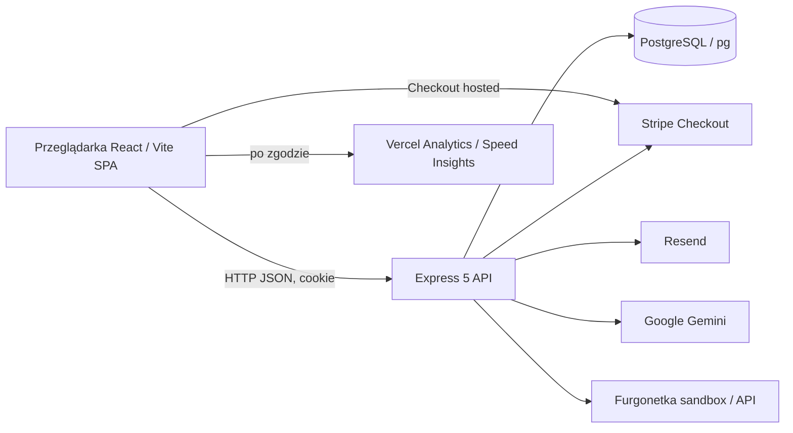
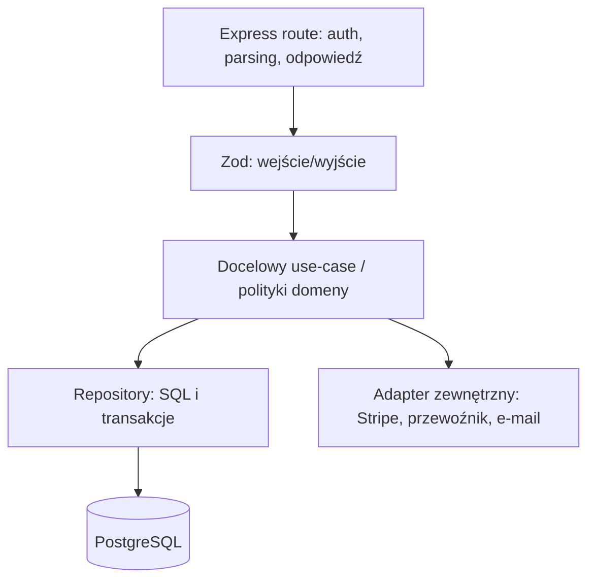

# VitaZone — stan techniczny i plan rozwoju

> **Jak czytać ten dokument:** „Stan kodu” oznacza obserwację z repozytorium; nie potwierdza zachowania na produkcji. „Ryzyko” oznacza konsekwencję możliwą na podstawie kodu. „Plan” i „hipoteza” wymagają wdrożenia lub badań. Nie użyto produkcyjnych danych, bazy ani sekretów. Ten dokument nie jest opinią prawną, audytem penetracyjnym ani raportem z badań klientów.

## 1. Podsumowanie dla właściciela

VitaZone jest sklepem React/Vite z osobnym API Express, PostgreSQL i integracją Stripe. Ma już podstawowe ścieżki katalogu, produktu, koszyka i gościnnej finalizacji. W tej iteracji poprawiono część języka interfejsu, kontrastu, modalu administracyjnego, walidacji schemy produktu i zabezpieczenia legacy resetu bazy. Największe ryzyka do rozwiązania przed traktowaniem sklepu jako gotowego do obsługi realnych transakcji to:

1. **Baza i migracje:** `schema.sql` zawiera destrukcyjny reset, indeksy odwołują się do tabel przed ich utworzeniem, a uruchamiacze migracji nie tworzą spójnego, wersjonowanego i transakcyjnego workflow.
2. **Źródło prawdy dla sklepu:** brak potwierdzenia danych firmy, e-maila, warunków dostaw/zwrotów, praw do zdjęć i prawdziwych parametrów produktów. Dokumenty prawne w aplikacji mają status roboczy.
3. **Wyszukiwalność katalogu:** produkt jest pobierany po stronie klienta, więc meta i JSON-LD powstają po hydracji; sitemap jest statyczna i nie wymienia produktów.
4. **Architektura backendu:** granice route/controller/use-case/repository są niespójne; kolekcje i paginacja wymagają ograniczeń; rate limiting w pamięci procesu nie daje globalnego limitu dla wielu instancji.
5. **Dowody jakości:** testy i lokalne mocki nie dowodzą zachowania produkcyjnego Stripe, Furgonetki, e-maili, bazy ani Core Web Vitals. Nie ma badań użytkowników ani analitycznych danych bazowych.

Motyw czerni i zieleni zostaje. Zielony ma działać jak akcent marki i orientacja, a nie ekranowa poświata ani stały efekt dekoracyjny. Poświatę kursora w tej iteracji zmniejszono do 96×96 px, `primary/3`, blur 32 px. Kierunek wizualny należy oceniać na prawdziwych fotografiach produktu, gdy właściciel potwierdzi źródło i przypisanie zdjęć.

## 2. Zakres i poziom pewności

| Etykieta | Znaczenie | Przykład |
|---|---|---|
| **Potwierdzone w kodzie** | Bezpośrednio odnalezione w pliku lub teście tej gałęzi. | React Router ma trasę `/checkout`; `schema.sql` zawiera `DROP TABLE`. |
| **Potwierdzone w lokalnym teście** | Test automatyczny wykonał konkretny scenariusz na fixture/mocku. | Dialog modalny przywraca fokus w teście JSDOM. |
| **Obserwacja statyczna** | Analiza źródła; bez renderu lub połączenia runtime. | Meta produktu jest ustawiana po fetchu w `useEffect`. |
| **Do potwierdzenia** | Wymaga właściciela, operatora, klienta lub środowiska. | Dane kontaktowe, zdjęcia, przewoźnik żywych zwierząt, rzeczywiste metody Stripe. |
| **Hipoteza** | Pytanie do zbadania; nie fakt o zachowaniu klientów. | Prowadzenie od potrzeby do kategorii może zmniejszyć niepewność wyboru. |

Zakres przeglądu obejmuje źródła frontendu i API, konfigurację builda, główne skrypty SQL, istniejące testy i dokumentację. Nie obejmuje aktywnej produkcji, testów penetracyjnych, inspekcji czytnikiem ekranu ani pomiarów polowych CWV.

## 3. Produkt i doświadczenie klienta

### Cel

Ułatwić wybór produktu odpowiedniego dla zwierzęcia i warunków, pokazać koszty i konsekwencje przed decyzją oraz umożliwić zakup z kontem lub bez. Jakość oceniać wspólnie przez ukończone, dopasowane zamówienia, anulowania, zwroty, pytania do obsługi i zgłoszenia niedopasowania — nie samą liczbę kliknięć.

### Dwie równorzędne podróże

1. **Pierwsze terrarium:** potrzeba → wymagania gatunku i warunków (wyłącznie zatwierdzone treści) → porównanie wyposażenia → sprawdzenie brakujących elementów → koszyk → dostawa i płatność.
2. **Uzupełnienie/rozbudowa:** konkretny gatunek lub część → wyszukiwanie/kategoria/filtry → karta produktu → kompatybilność potwierdzona danymi → koszyk → dostawa i płatność.

To mapy do walidacji, nie persony oparte na danych. Rozpocząć od wywiadów kontekstowych i iteracyjnych testów użyteczności z obiema grupami. Około pięciu osób w grupie może ujawnić wczesne bariery jakościowe, lecz wynik nie jest reprezentatywną statystyką. Klientów nie rekrutowano w ramach tego audytu.

### Zasady perswazji i tekstu

- Psychologia ma ograniczać niepewność: ujawniać cenę, zawartość zestawu, wymagania, dostępność i następny krok przed podjęciem decyzji.
- Nie używać fałszywego niedoboru, odliczania, presji, fikcyjnych opinii/popularności ani ukrywania kosztów.
- CTA nazywa skutek („Dodaj do koszyka”, „Pokaż produkty”), a nie abstrakcyjne „Dalej”. Błąd wyjaśnia przyczynę i drogę naprawy.
- Nie formułować porad hodowlanych z uogólnionych szablonów. Informacje o żywym zwierzęciu muszą być potwierdzone dla konkretnego produktu/osobnika.
- Twierdzenia o firmie, dostawie, bezpieczeństwie, popularności i jakości wymagają źródła dowodowego i właściciela odpowiedzialnego za aktualizację.

## 4. Mapa tras interfejsu

Źródło: `src/App.jsx`; trasy są ładowane przez `lazyWithRetry`. Nawigacja nie dowodzi, że integracja backendu lub treść jest gotowa.

| Trasa | Moduł | Rola i uwagi |
|---|---|---|
| `/` | `src/pages/Home.jsx` | wejście do katalogu i dwie ścieżki zakupowe; sprawdzić czy język nie obiecuje gotowego zestawu bez danych. |
| `/shop` | `src/pages/Shop.jsx` | wyszukiwanie, kategorie, zakres ceny, sortowanie, karty i stany błędu/puste. |
| `/product/:id` | `src/pages/ProductDetail.jsx` | szczegóły, zdjęcia, dodanie do koszyka, meta i JSON-LD ustawiane po stronie klienta. |
| `/about` | `src/pages/About.jsx` | obecny opis asortymentu/sklepu; brak potwierdzonej historii marki. |
| `/contact` | `src/pages/Contact.jsx` | dane kontaktowe wymagają potwierdzenia właściciela. |
| `/faq` | `src/pages/FAQ.jsx` | odpowiedzi muszą zgadzać się z faktyczną logistyką, płatnościami i obsługą. |
| `/terms` | `src/pages/legal/TermsAndConditions.jsx` | wersja robocza do przeglądu prawnego i danych sprzedawcy. |
| `/privacy` | `src/pages/legal/PrivacyPolicy.jsx` | potwierdzić administratora, cele, podstawy, odbiorców, okresy i prawa. |
| `/cookies` | `src/pages/legal/CookiesPolicy.jsx` | zgodność treści z faktycznie uruchamianymi skryptami. |
| `/withdrawal` | `src/pages/legal/Withdrawal.jsx` | nie publikować ogólnych wyjątków bez analizy rodzaju produktu i obowiązującego prawa. |
| `/login` | `src/pages/Login.jsx` | logowanie; klient może kupić jako gość. |
| `/register` | `src/pages/Register.jsx` | rejestracja opcjonalna; nie obiecywać niezweryfikowanych korzyści. |
| `/checkout` | `src/pages/Checkout.jsx` | dane gościa/konta, dostawa, podsumowanie i przejście do Stripe; trzeba potwierdzić aktywne metody i stany awarii. |
| `/dashboard` | `src/pages/Dashboard.jsx` | historia konta; akcje kontaktowe mailto nie są zautomatyzowanym zwrotem/reklamacją. |
| `/admin` | `src/pages/AdminDashboard.jsx` | panel admina; sprawdzić role, paginację, teksty i obsługę produktu. |
| `*` | `src/pages/NotFound.jsx` | strona nieznanej trasy; dodać obserwację SEO statusu HTTP hosta. |

Wspólna powłoka w `src/App.jsx`: `AuthProvider`, `CartProvider`, `Navbar`, `Footer`, `ScrollToTop`, granica `Suspense`, consent, chat, analityka po zgodzie i desktopowe efekty tła. Dane dostępu i kosztorysy przed zakupem są implementowane poza samą trasą; sprawdzić cały przepływ, nie tylko widok.

## 5. Przegląd modułów i odpowiedzialności

Poniższa mapa opisuje pliki domenowo, aby aktualizować ją wraz ze zmianami. Nie jest sztucznym opisem każdej linijki; przy każdym module wskazuje rolę, zależności i ważny punkt kontroli.

### Frontend — powłoka, UI i domena

| Plik / grupa | Odpowiedzialność w kodzie | Kontrola rozwoju |
|---|---|---|
| `src/main.jsx`, `src/App.jsx` | bootstrap React, routing, providery, lazy chunks, wspólna powłoka i warunkowe ładowanie widgetów. | utrzymać mały bootstrap, jawne granice błędów i lazy fallbacks dostępne dla klawiatury/czytnika. |
| `src/index.css`, `src/App.css`, `tailwind.config.js`, `postcss.config.js` | bazowy CSS i tokeny Tailwinda 3.4. | jeden słownik tokenów, bez migracji Tailwind 4 w ramach refinementu; mierzyć bundle po zmianach. |
| `src/components/Navbar.jsx`, `Footer.jsx`, `ScrollToTop.jsx` | globalna nawigacja, linki pomocnicze i zachowanie nawigacyjne. | sprawdzać mobilne menu, focus order, nazwy linków i prawdziwość danych kontaktowych. |
| `src/components/CartDrawer.jsx` | widok koszyka i jego modalne interakcje. | pojedyncze źródło kwot, semantyka dialogu, Escape, pułapka/zwrot fokusu i pusty stan. |
| `src/components/ProductModal.jsx` | formularz admina do tworzenia/edycji produktu i uploadu. | obecnie dodano dialog/fokus/etykiety; kolejne kroki: walidacja schemy produktowej, upload, błędy sieci i testy keyboard. |
| `src/components/CookieBanner.jsx`, `src/utils/consent.js` | pobranie i zapis wyboru cookies. | gwarantować, że odmowa blokuje skrypty opcjonalne, nie tylko zapisuje stan; testować zgodę, odmowę i ponowne otwarcie. |
| `src/components/ChatWidget.jsx` | UI czatu katalogowego; kontaktuje się z endpointem API. | jasno ujawnić odbiorcę/model i dane wysyłane do Google; nie przedstawiać jako weterynarza. |
| `src/components/MouseGlow.jsx` | dekoracyjny podążający halo dla precyzyjnego wskaźnika desktop. | bieżący wariant 96 px/3%/32 px; wyłączyć na dotyku i reduced-motion; usunąć, jeśli test wizualny pokaże rozproszenie. |
| `src/components/ErrorBoundary.jsx`, `LegalDraftNotice.jsx`, `VercelInsights.jsx` | granica błędu UI, oznaczenie roboczych dokumentów i warunkowy loader telemetryczny. | raportować błąd bez danych osobowych; insights tylko zgodnie z decyzją consent. |
| `src/context/AuthContext.jsx` | stan sesji, login/logout/odtworzenie sesji z API. | backend jest autorytatywny; nie ufać wartościom profilu zapisanym w przeglądarce. |
| `src/context/CartContext.jsx` | pozycje koszyka, zmiany ilości i persistencja po stronie klienta. | traktować koszyk jako intencję; backend przelicza ceny, rabat, dostępność i kwoty przy zamówieniu. |
| `src/data/storefrontData.js` | lokalne dane/ustawienia do prezentacji storefrontu. | jasno oddzielać fixture od źródła produkcyjnego; nie traktować ich jako katalogu aktualnych ofert. |
| `src/utils/analytics.js` | bezpieczne wywołanie zdarzeń analitycznych po zgodzie. | nie przesyłać treści zapytania, e-maila, adresu ani danych zwierzęcia; mieć politykę retencji i cel. |
| `src/utils/consent.js`, `fetchJson.js`, `config.js` | odczyt preferencji, normalizacja odpowiedzi HTTP i adresu API. | jednolite timeouty, sygnały anulowania, mapowanie błędów i environment config. |
| `src/utils/imageUtils.js`, `grammarUtils.js` | transformacja URL/źródeł obrazów i polska odmiana liczebników. | whitelist hostów/formatów dla URL; odmiany testować dla 0, 1, 2–4 i 5+. |
| `src/utils/productBadges.js`, `productSorting.js`, `productSchema.js`, `jsonLd.js` | reguły odznak/sortowania, budowanie Product JSON-LD i bezpieczna serializacja. | nie emitować fałszywej popularności; schema wyłącznie z widocznych, aktualnych danych i prawidłowej ceny. |
| `src/utils/lazyWithRetry.js` | ponawianie pobrania chunka po błędzie. | sprawdzić limit retry i brak pętli; używać w połączeniu z granicą błędów. |

### Backend — HTTP, domeny, dane i integracje

| Plik / grupa | Odpowiedzialność w kodzie | Kontrola rozwoju |
|---|---|---|
| `server.js`, `api/index.js` | Express middleware, CORS, Helmet, webhook raw body, limity, route mounting i handler błędów; `api/index.js` eksportuje aplikację dla Vercel. | webhook musi zachować raw body; testować origins, proxy, timeouty serverless i obsługę błędów. |
| `server/config/env.js`, `http.js`, `logger.js`, `rateLimiters.js`, `requestContext.js` | walidacja konfiguracji, origins, logger, limity i request id/kontekst. | sekrety tylko env manager; redagować PII; rozważyć współdzielony storage limitów dla instancji. |
| `server/middleware/authMiddleware.js`, `csrfMiddleware.js`, `errorHandler.js` | uwierzytelnienie/autoryzacja, weryfikacja pochodzenia żądań zapisujących i mapowanie błędów. | dla każdej trasy potwierdzić rolę i masę danych; testy negatywne dla origin, sesji, admina. |
| `routes/authRoutes.js`, `schemas/userSchema.js`, `repositories/userRepository.js` | rejestracja, logowanie i sesja użytkownika. | hasła hash, cookie flags, enumeracja kont, brute force, RODO/retencja i reset hasła. |
| `routes/catalogRoutes.js`, `schemas/productSchema.js`, `repositories/productRepository.js` | publiczny katalog, szczegół produktu i odczyt/zapis produktu. | page/limit z twardym maximum; filtrowanie/indeksy; URL obrazów i `specs` wymagają ścisłego Zod zamiast `z.any()`. |
| `routes/cartRoutes.js`, `schemas/cartSchema.js`, `repositories/cartRepository.js` | koszyk powiązany z kontem i jego pozycje. | uniknąć utraty/duplikacji w synchronizacji; klient nie ustala ceny ani stanu magazynowego. |
| `routes/orderRoutes.js`, `schemas/orderSchema.js`, `repositories/orderRepository.js` | tworzenie/odczyt zamówień, snapshoty i transakcje. | oddzielić orkiestrację use-case od SQL; idempotency, rezerwacje, stany wyścigu, retencja i paginacja. |
| `routes/stripeRoutes.js`, `schemas/stripeSchema.js`, `server/controllers/stripeController.js` | tworzenie sesji płatności i obsługa webhooków Stripe. | podpis webhooka, replay/idempotency, zwroty/wygaśnięcia/anulowania, brak zaufania do kwoty klienta. |
| `routes/shippingRoutes.js`, `schemas/shippingSchema.js`, `server/services/shippingService.js`, `shippingSnapshot.js`, `shipping/furgonetkaClient.js` | walidacja danych paczki i adresu, wycena/serializacja snapshotu dostawy i klient Furgonetki. | PR #1 deklaruje tylko integrację sandboxową/wyceny; nie etykiety ani aktywną usługę. Potwierdzić umowy, zakres przewozu, ochronę danych i awarie. |
| `routes/discountRoutes.js`, `schemas/discountSchema.js`, `repositories/discountRepository.js` | walidacja kodu i persystencja promocji. | serwerowa walidacja czasu, limitów, kwalifikacji i współbieżnego użycia. |
| `routes/legalRoutes.js`, `schemas/legalSchema.js`, `repositories/legalRepository.js` | zapis/odczyt zgód/formalnych potwierdzeń. | minimalizować IP; udokumentować podstawę, cel i retencję; zgoda marketingowa osobno od koniecznej obsługi zamówienia. |
| `routes/chatRoutes.js`, `schemas/chatSchema.js`, `server/controllers/chatController.js` | walidacja rozmowy i zewnętrzne żądanie do modelu. | jawne ujawnienie przekazania danych i retencji dostawcy; limity tokenów/cost, brak porad medycznych. |
| `routes/uploadRoutes.js`, `server/services/imageService.js`, `storageService.js` | kontrola uploadu, obróbka Sharp i zapis/odpowiedź obrazu. | potwierdzić MIME/rozmiar/rozmiar pikseli, metadane EXIF, ACL i storage; base64 data URI nie jest skalowalnym CDN. |
| `server/services/emailService.js` | wysyłanie komunikatów transakcyjnych przez Resend. | potwierdzić SPF/DKIM/DMARC, treść, statusy, retry i brak sekretów/PII w logach. |
| `server/scripts/*` | utrzymanie/diagnostyka/seed/import/migracje. | skrypty destrukcyjne i produkcyjne wymagają osobnej ochrony/uwagi; `pnpm migrate` jest legacy resetem i blokowany domyślnie. |

### Testy i uruchamianie

- `src/tests/integration/` — testy komponentów i kontekstów w JSDOM/Testing Library; nie zastępują testu prawdziwej przeglądarki.
- `tests/unit/` — reguły, walidacje i funkcje server-side w izolacji.
- `tests/e2e/` — scenariusze Playwright; obecne fixture stubbują API i więc nie potwierdzają produkcyjnego backendu/operatorów.
- `vite.config.js` — Vite, React plugin, proxy `/api` do `localhost:3001`, build `esnext`, osobne ręczne chunki ikon i telemetryki oraz konfiguracja Vitest.
- `playwright.config.js` — kontekst i porty testowe; zapis wyników tylko do katalogów testowych.
- `.env.example` — nazwy wymaganych ustawień, bez sekretów; nie publikować pliku `.env` ani logów środowiska.
- `package.json` / `pnpm-lock.yaml` — pnpm 10.33.0 jest zadeklarowanym managerem; istniejący `package-lock.json` to konflikt źródeł zależności do rozstrzygnięcia, nie usuwać bez odtworzenia instalacji i CI.

## 6. Architektura i przepływy

### Widok systemu (C4 — kontenery)



Diagram pokazuje integracje odnalezione w kodzie i dokumentacji PR. Nie potwierdza aktywności produkcyjnej ani umów. Furgonetka wymaga właścicielskiego potwierdzenia konta/trybu; Vercel Analytics jest warunkowane zgodą w UI.

### Przepływ zakupu

1. Przeglądarka pobiera katalog i przechowuje intencję koszyka w `CartContext`.
2. Checkout zbiera e-mail, dostawę i niezbędne dane; serwer waliduje payload przez Zod.
3. Serwer ponownie wycenia produkty, rabat, stan i usługę dostawy, a następnie tworzy order/snapshot w PostgreSQL.
4. Serwer inicjuje Stripe Checkout. Przeglądarka nie może być źródłem ceny, `userId` ani statusu zapłaty.
5. Stripe wywołuje podpisany webhook; ten jest źródłem potwierdzenia statusu asynchronicznego i idempotentnie aktualizuje zamówienie.
6. Klient dostaje potwierdzenie i późniejsze informacje e-mailem; gość nie uzyskuje historii po samym numerze zamówienia.

Przed uznaniem tego za produkcyjnie gotowe trzeba sprawdzić kod wszystkich branchy płatności i awarii (wygaśnięcie, cancel, niepowodzenie, retry webhooka, brak towaru/wyceny i timeout e-maila) z testami kontraktowymi i Stripe CLI na osobnym testowym koncie. Dokumentacja PR nie jest dowodem transakcji live.

### Granice odpowiedzialności — obecna i docelowa



To **kierunek docelowy**, a nie pełny opis stanu obecnego: admin routes wykonują SQL bezpośrednio; `orderRepository` zawiera część transakcyjnej orkiestracji i kompatybilności schematu; brak jednolitej warstwy use-case. Refaktoryzować domenami, dopiero gdy kontrakty i regresje są pokryte testami.

## 7. PostgreSQL — stan faktyczny i docelowa baza

### Zastany schemat

Główny plik `schema.sql` deklaruje `users`, `addresses`, `categories`, `products`, `orders`, `order_items`, `legal_consents`, `carts`, `cart_items`. Używa UUID, `price_cents`/`total_amount_cents`, JSONB dla specyfikacji i snapshotu adresu, kluczy obcych oraz części indeksów. Folder `server/scripts/migrations/` zawiera pięć migracji przyrostowych (idempotency key, discount codes, snapshoty pozycji, snapshot podatku, podatek produktu) oraz SQL rollback dla kilku z nich.

### Krytyczne rozbieżności

- `schema.sql` rozpoczyna się `DROP TABLE` i nie jest bezpieczną migracją w przód.
- Indeksy `idx_carts_user`, `idx_consents_user`, `idx_consents_ip` występują przed `CREATE TABLE carts` i `legal_consents`; czysta baza może przerwać skrypt.
- Reset pomija `cart_items` i `legal_consents` przy usuwaniu. Pozostałe klucze obce mogą uniemożliwić ponowne stworzenie tabel lub pozostawić tabelę w nieznanym stanie.
- `VitaZonedb.sql` jest odrębnym, starszym schematem, więc nie może być równorzędnym źródłem prawdy.
- `server/scripts/run-migrations.js` szuka `migrate_*.js`/`run_migration_*.js` w katalogu skryptów, uruchamia child process i dopisuje ledger po fakcie. Nie aplikuje `.sql` z katalogu `migrations/` i nie obejmuje skryptu transakcją; katalogowa konwencja nie pasuje do realnych migracji.
- `pnpm migrate` wywołuje reset przez `schema.sql`; dodana w tej gałęzi bramka wymaga `ALLOW_DESTRUCTIVE_SCHEMA_RESET=true`, drugi opt-in dla zdalnej bazy i odmawia środowiska production/Vercel. To awaryjna osłona legacy, **nie naprawa systemu migracji**.

Żaden skrypt migracji/resetu nie został uruchomiony w audycie. Nie łączyć się do realnej bazy.

### Docelowy model i operacyjna jakość danych

Najpierw sporządzić inwentaryzację wszystkich zapytań i statusów. Docelowy workflow:

1. Jedno katalogowe źródło schematu i wersjonowane migracje append-only; każda zmiana ma `up`, przemyślany `down` lub jawne uzasadnienie braku bezpiecznego rollbacku.
2. Test migracji na pustej bazie PostgreSQL w CI oraz upgrade na reprezentatywnej fixture starej wersji; sprawdzanie sum kontrolnych i kolejności.
3. Runner rejestruje wersję w ledgerze i aplikuje migrację atomowo (tam gdzie typ DDL pozwala), blokuje współbieżne uruchomienia i kończy niezerowym kodem po błędzie.
4. Backup/restore z próbą odtworzenia, osobne role runtime/migrator, least privilege, timeouty, limit połączeń i monitoring puli.
5. Dane pieniężne wyłącznie jako integer groszy, jasno określona waluta; zamówienie i pozycje zawierają immutable snapshot nazwy, SKU, ceny, stawki podatkowej, wysyłki i rabatu.
6. Check/unique/FK constraints dla statusów, ilości, cen, sluga, rabatu i idempotency; jawne reguły ON DELETE; indeksy zgodne z filtrami/ORDER BY i sprawdzone `EXPLAIN (ANALYZE, BUFFERS)` na danych syntetycznych.
7. Paginacja kursorowa lub limit-offset z maksymalnym `limit`, stabilnym porządkiem i testem ochrony przed enumeracją; nigdy nie zwracać wszystkich zamówień użytkownika/admina bez limitu.
8. Prywatność: nie przechowywać IP „dla wygody”; określić cel/retencję, minimalizować adresy i ograniczać dostęp do snapshotów zamówień.

Przed migracją właściwego środowiska wymagane są backup, plan okna, dry-run na kopii, weryfikacja checksum i podpis właściciela bazy. Tego planu nie wykonano.

## 8. Jakość kodu, bezpieczeństwo, wydajność

### Potwierdzone lub widoczne w kodzie

- Parametryzowane SQL, walidacja Zod, `helmet`, allowlista CORS, cookies ustawiane z bezpiecznymi flagami, CSRF origin check, bcrypt, podpis Stripe webhooka i restrykcja uploadu/admina są obecne w wybranych ścieżkach. Obecność nie oznacza pokrycia wszystkich tras ani testu penetracyjnego.
- Publiczne katalogowanie oraz część kolekcji administracyjnych/historii wymaga limitów i walidacji granicznych.
- Rate limiting jest stanem lokalnego procesu; przy wielu instancjach nie musi być wspólny.
- `productSchema` backendu wymaga jawnej walidacji `image_urls` i `specs`, zamiast przyjmowania dowolnego kształtu. Nie zmieniać kontraktu bez przeglądu fixture i admin form.
- Upload po obróbce zwraca obecnie data URI; storage object/CDN rozważyć po sprawdzeniu ruchu i kosztu, nie jako domyślną przebudowę.
- Quote dostawy powinien korzystać z jednego zestawu usług w obrębie requestu; współbieżność i cache dopiero po sprawdzeniu limitów dostawcy i zmienności taryf.
- Route chunks, lazy UI, osobne chunki ikon/telemetryki, defer dla widgetów i rozmiary obrazów są już stosowane. Nie zakładać, że dalsze rozbijanie providerów poprawi runtime bez React Profiler.

### Wydajność — wymagany pomiar

Nie ma tutaj pomiaru runtime ani danych field. Najpierw zmierzyć produkcyjny build z ustalonym zestawem tras, viewportem, cachem i powtarzalnym throttlingiem; podać wersję przeglądarki, medianę i rozrzut. CWV ocenia się na 75. percentylu realnych wizyt: LCP ≤2,5 s, INP ≤200 ms, CLS ≤0,1 (źródło web.dev). Dla labu raportować osobno Lighthouse/WebPageTest i nie nazywać go field pass.

## 9. Treści, SEO i prawo

### Treść i katalog

- `/shop` ma kategorie, zakres ceny, wyszukiwanie, sortowanie i liczbę wyników. Przy błędzie API aktualny UI pokazywał dwa nakładające się komunikaty pustego katalogu/błędu; zmieniono warunek tak, by pozostawić jedno źródło błędu z przyciskiem ponowienia.
- Widoczne odznaki mają wynikać z udokumentowanych danych katalogu, nie z marketingowego skrótu. Powtarzające się zdjęcia węży i źródła/licencje obrazów czekają na potwierdzenie właściciela.
- Dane firmy, godziny obsługi, realna dostępność kontaktu, dostawa i zwroty są właścicielskimi faktami. Nie uzupełniać ich fikcyjnymi wartościami.
- Język testować na fragmentach rozmów obsługi/anulowań po anonimizacji i zgodzie, a następnie w dwóch iteracyjnych grupach klientów.

### SEO

- `src/App.jsx` ustawia ogólny title/description; `ProductDetail` ustawia własne title/description/canonical/Product JSON-LD po client fetch.
- `public/sitemap.xml` zawiera tylko statyczne homepage, shop, about, contact i FAQ; nie ma adresów aktywnych produktów, kategorii ani stron prawnych. Canonical i host używają `vitazone.vercel.app` na sztywno.
- Plan: ustalić kanoniczny domenowy URL, przenieść metadane krytyczne SEO na SSR/SSG/prerender per produkt/kategoria lub potwierdzić renderowanie indeksujące na live URL; sitemap generować z aktywnego katalogu i aktualizować przy publikacji. Rozważyć Vite prerender przed migracją frameworka, porównać koszty i deployment constraints.
- `robots.txt`, canonicale, `noindex` dla admina/konta/checkoutu, status 404, Open Graph, breadcrumbs i sitemap testować na gotowym HTML oraz crawl. Product schema ma odzwierciedlać widoczne dane i pomijać zero/nieważne ceny (poprawka w tej gałęzi).
- Wstawić wyłącznie schema zgodne z widocznym tekstem i aktualną ofertą. Nie generować fikcyjnego `AggregateRating`, stanów ani FAQ.

### Obowiązki prawne — Polska

Repo ma oddzielny [przegląd polskiego prawa](../research/vitazone-polish-consumer-law-review.md). W aplikacji znajdują się projekty regulaminu, prywatności, cookies i odstąpienia; sama obecność strony nie potwierdza zgodności. Przed sprzedażą właściciel i prawnik muszą ustalić dane przedsiębiorcy, łączny koszt, przedpłatę/płatności, czas i sposób dostawy, reklamacje, odstąpienie i informacje o produktach, w tym sprzedaż zwierząt. Względem żywych zwierząt nie zakładać blanketowego wyjątku od prawa odstąpienia. Polityka prywatności ma odzwierciedlać rzeczywistych odbiorców: Stripe, dostawcę wysyłki, e-mail, Google AI i narzędzia analityczne. To lista kontrolna, nie interpretacja indywidualnej sytuacji.

## 10. Badania i benchmarki

Źródła porównawcze do ręcznej analizy: Gekonowa Pasja, Terran Polska, Zmiennocieplne i TerraRex (pełny plan i linki w [UX research](../research/vitazone-ux-research.md)). Dla każdej obserwacji zachować URL, datę, screen, urządzenie i oddzielić fakt od oceny. Nie kopiować ich claimów ani zakładać, że oferta lub prawo logistyczne jest tożsame.

Baymardowe rekomendacje filtrowania/checkoutu są zewnętrznymi hipotezami, nie danymi o klientach VitaZone. Badanie własne powinno porównać wyszukiwanie, filtrowanie, aktywne filtry, kompletność informacji, koszty i checkout bez konta, bez testu A/B przed wystarczającym ruchem.

## 11. Plan wdrożenia i bramki

Priorytety to sekwencja; estymacja wymaga potwierdzenia zakresu i właścicieli. Wszystkie zmiany kodu tej iteracji należą do branchy PR #2, bez integracji do `main` i bez deploymentu.

| Etap | Priorytet / rezultat | Zależności | Kryterium zakończenia |
|---|---|---|---|
| A. Zamrożenie prawdy katalogu i firmy | **P0:** właściciel zatwierdza dane, kontakty, zdjęcia/licencje, opisy, warunki dostawy/zwrotów i metody płatności. | Odpowiedź właściciela, umowy/źródła, przegląd prawny. | Rejestr twierdzeń ma źródło, opiekuna i datę przeglądu; placeholdery nie trafiają do publicznych stron. |
| B. Bezpieczna baza i migracje | **P0:** nowy ledger/migrator, jeden kanoniczny schemat i procedura backup/restore. | Inwentaryzacja realnych wersji schematu na kopii, bez dumpowania danych w logu. | Pusta baza i upgrade fixture przechodzą CI; destructive reset odseparowany; checksum, lock i niezerowy exit. |
| C. Checkout i operacje | **P0:** spójny model statusów/idempotency/rezerwacji, guest/account, awarie Stripe, dostawa i wiadomości. | Test Stripe, aktywowane metody, zweryfikowany przewoźnik i warunki obsługi zwierząt. | Kontraktowe testy webhook retry/expiring/cancel/fail/duplicate/stock race; jasne UX i mail; brak nieautoryzowanego order read. |
| D. Stabilizacja API i danych | **P1:** paginacja, limity, ścisłe schema, adaptery, jednolite use-case granice. | C/B i obecne kontrakty API. | Maksymalny limit, stabilne sortowanie, testy auth/negative/race, SQL explain na syntetycznych danych, brak regresji admina. |
| E. UX i język na podstawie badań | **P1:** dwie ścieżki, wyszukiwalność i copy po iteracyjnych testach. | Uczestnicy z obu grup, zanonimizowane pytania klientów za zgodą. | Zadania i bariery opisane cytatem bez PII; iteracja po każdym teście; brak claimów niepopartych danymi. |
| F. SEO/rendering i wydajność | **P1:** crawl produktów/kategorii, sitemap i pomiary. | Kanoniczny host, stabilny katalog, wybór SSR/SSG/prerender. | Direct HTML zawiera title/canonical/product schema; sitemap aktualna; lab i field wyniki rozdzielone. |
| G. Design polish i WCAG | **P1:** dopracowanie fotografii/rytmu, inputów, błędów, motion i dostępności. | Potwierdzone assety; rendering desktop/mobile. | WCAG 2.2 AA review, klawiatura, screen reader, 200% zoom, kontrast, reduced motion i real device. |
| H. Uruchomienie | **P0 release gate:** legal signoff, płatności/kurierzy, backup, alerty i runbook. | Etapy A–G, osobny jawny release order. | Test sandbox i kontrolowana transakcja testowa; rollback sprawdzony; udokumentowany incident owner; dopiero osobne polecenie wdrożenia. |

### Metryki i ochrony

- Funnel: search/category → product → cart → checkout step → paid; rozdzielić first setup vs replenishment tylko za zgodą i przy możliwości wiarygodnego określenia.
- Ochrona jakości: anulowania i zwroty, kontakt do obsługi, sygnały niedopasowania, opóźnienia/awarie dostawy i płatności.
- Prywatność: minimalna analityka po zgodzie; bez wrażliwych pól, e-maila, dokładnych adresów i pełnego search string.
- Nie uruchamiać A/B bez sensownej mocy i miary guardrail. Zmiana wzrostu klików nie oznacza wzrostu dopasowanych zamówień.

## 12. Akceptacja i odtworzenie

### Testy kodu

Po każdej zmianie uruchomić zakresowe testy, a przed końcem iteracji istniejące kontrole projektu:

```powershell
pnpm exec vitest run
pnpm lint
pnpm build
pnpm check:secrets
$env:PLAYWRIGHT_PORT = '4182'; pnpm test:e2e
```

Playwright używa mock API i danych demo. Zmienne `DATABASE_URL`, klucze Stripe/Resend/Furgonetka/Gemini i realne profile nie mogą trafiać do testu. Nie uruchamiać `pnpm migrate` ani seed/import przeciw bazie bez disposable local fixture oraz osobnego review.

### Testy UX i dostępności przed release

- Przejść wszystkie 16 tras desktop/mobile i stany loading/error/empty/success; każdą publiczną akcję klawiaturą.
- 360/390/768/1440 px, zoom 200% w przeglądarce (nie tylko węższy viewport), brak overflow i strata treści.
- Screen reader nawigacja landmarks, nazw kontrolki, formularze/błędy, dialog i status koszyka.
- WCAG 2.2 AA: kontrast, widoczny i niezasłonięty fokus, rozmiar celów, ograniczony ruch i autouzupełnianie.
- Rzeczywiste zdjęcia i polskie długie nazwy; alt opisuje produkt, a nie ozdobną powtórkę.
- SEO: bezpośrednie pobranie HTML produktu, robots/canonical/status code/sitemap/schema walidowane na środowisku preview.
- Operacje: tylko sandbox providerów; success/cancel/failed/async/double webhook/timeout/out-of-stock/price change; sprawdzone maile bez PII w logach.

## 13. Dokumentacja i źródła zewnętrzne

Struktura dokumentacji ma oddzielać wyjaśnienie (ten plik), referencję modułów/API, instrukcje operacyjne i tutoriale, zgodnie z [Diátaxis](https://diataxis.fr/). Architektura używa tylko potrzebnych poziomów C4 ([intro](https://c4model.com/introduction)).

- [React Suspense](https://react.dev/reference/react/Suspense) — granice asynchronicznego renderowania i lazy chunks.
- [WCAG 2.2](https://www.w3.org/TR/WCAG22/) — kryteria dostępności.
- [Google: dane strukturalne e-commerce](https://developers.google.com/search/docs/specialty/ecommerce/include-structured-data-relevant-to-ecommerce) — schema musi odzwierciedlać ofertę.
- [Core Web Vitals](https://web.dev/articles/defining-core-web-vitals-thresholds) — progi p75, mierzyć pole oddzielnie od lab.
- [UOKiK: obowiązek informacji przy sprzedaży na odległość](https://prawakonsumenta.uokik.gov.pl/prawo-do-informacji/sprzedaz-poza-lokalem-i-na-odleglosc/).
- [Tekst ustawy o prawach konsumenta, ELI, Dz.U. 2026 poz. 1244](https://eli.gov.pl/api/acts/DU/2026/1244/text/U/D20261244Lj.pdf) — stan sprawdzany 2026-11-14; przed wydaniem sprawdzić aktualność.
- [FTC: dark patterns report](https://www.ftc.gov/system/files/ftc_gov/pdf/P214800%20Dark%20Patterns%20Report%209.14.2022%20-%20FINAL.pdf) — międzynarodowy materiał projektowy; nie zastępuje polskiej analizy prawnej.

## 14. Historia tej iteracji

W PR #2 (gałąź `codex/vitazone-visual-refresh`) przed zakończeniem audytu wprowadzono lokalnie:

- ochronę legacy skryptu `pnpm migrate` poprzez osobne opt-in, zakaz w produkcji/Vercel i dodatkowy opt-in dla zdalnej bazy; czystszy exit/error handling;
- testy bramki bezpieczeństwa resetu;
- nieemitowanie Product Offer dla wartości `price_cents = 0`;
- dialog `ProductModal` z etykietami, Escape, pętlą fokusu i przywróceniem fokusu;
- poprawki języka w checkout/konto/panelu i kontrast pomocniczego tekstu;
- ograniczenie halo kursora do 96×96 px, zieleni 3%, blur 32 px;
- usunięcie drugiej pustej wiadomości listingu, gdy katalog API już wyświetla stan błędu;
- dokument indeksu, mapy stanu i ten plan.

Te zmiany nie są scalone do `main` ani wdrożone. Wyniki kontroli finalnej znajdują się w [notatkach roboczych](working-notes.md) i muszą zostać dopisane po wykonaniu bieżącej weryfikacji. Wcześniejsze wyniki PR/agentów nie zastępują końcowego runu aktualnego drzewa.
